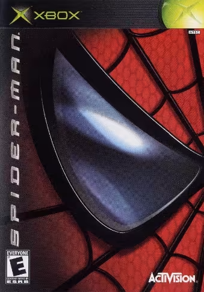
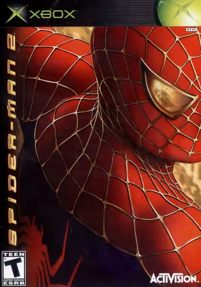
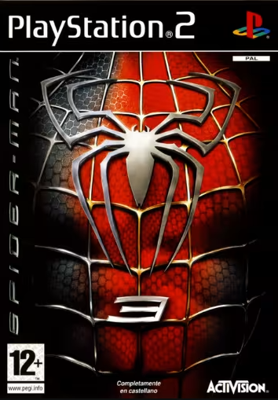

# opentobey-spiderman-trilogy
## Spider-Man: The Movie 1-2-3 
A recreation of *Spider-Man: The Movie*, *Spider-Man 2*, and *Spider-Man 3* — all three movies rebuilt in the **first game's engine** (*Spider-Man: The Movie*, 2002), so they can be extended, modded, and preserved.

---

## About
All three Spider-Man movie games, recreated on the original *Spider-Man: The Movie* (2002) engine. The first game's web-swinging, combat, and level design, carrying the story and set pieces of all three films — one engine, one continuous trilogy.

## GitHub Treeview
[https://treegit.macosxjs.com/?url=igiteam/opentobey-spiderman-trilogy](https://treegit.macosxjs.com/?url=igiteam/opentobey-spiderman-trilogy)

## GitHub Tree API (Direct JSON)
[https://api.github.com/repos/igiteam/opentobey-spiderman-trilogy/git/trees/main?recursive=1](https://api.github.com/repos/igiteam/opentobey-spiderman-trilogy/git/trees/main?recursive=1)

## Spider-Man The Movie Game — the base of the gameplay

## WS11WineCX20.0.4 (macOS Big Sur 32-bit)
[WS11WineCX20.0.4.tar.7z](https://github.com/vitor251093/porting-kit-engines/releases/download/wineskin/WS11WineCX20.0.4.tar.7z)

## Reference Links
[https://github.com/xdivorex-gif/spiderman-kraven-pc](https://github.com/xdivorex-gif/spiderman-kraven-pc)

[https://archive.org/details/Spider-Man_The_Movie_Reissue_USA](https://archive.org/details/Spider-Man_The_Movie_Reissue_USA)

[https://archive.org/details/spider-man-2-2004-activision](https://archive.org/details/spider-man-2-2004-activision)

[https://github.com/SirSymo/SM2-Recomp](https://github.com/SirSymo/SM2-Recomp)

# open-tobey a Spider-Man: The Movie Game dissection

This repository contains a partial decompilation of the PC version of Treyarch's first Spider-Man game.

For a stable release download the zip from the Release tab. For bleeding edge go to the actions tab and download the artifact from the the latest succesful pipeline run.

NOTE: Make sure you have [Patch 1.3](https://community.pcgamingwiki.com/files/file/791-spider-man-the-movie-patch-13/) installed.

## Installation

1. Rename the game's `binkw32.dll` to `binkw32_.dll`
2. Extract `binkw32.dll` from the zip to the game directory

## Screenshots

## Dev Environment

**Official White Wii Remote With Nunchuk — Tested And Working — £14.99**
[https://www.ebay.co.uk/itm/800847189353](https://www.ebay.co.uk/itm/800847189353)

**Infrared Sensor Bar USB for Wii Emulator Remote Motion Detection Setup — £6.69**
[https://www.ebay.co.uk/itm/227423830875](https://www.ebay.co.uk/itm/227423830875)

**Apple MacBook Pro Retina 15in (2014) i7 2.8GHz 16GB 1TB SSD GT 750M — £120.30**
[https://www.ebay.co.uk/itm/800844561513](https://www.ebay.co.uk/itm/800844561513)

**WS11WineCX20.0.4 (Wine engine)**
[https://igiteam.github.io/wine_engines/](https://igiteam.github.io/wine_engines/)

**Official Genuine Sony PS3 PlayStation 3 DualShock 3 Wireless Controller Black — £19.99**
[https://www.ebay.co.uk/itm/840031043465](https://www.ebay.co.uk/itm/840031043465)

**Amazon Basics 4K HDMI Cable 3m — 18Gbps High Speed with Ethernet, 4K@60Hz, 2160p — £8.44**
[https://www.ebay.co.uk/itm/327352257557](https://www.ebay.co.uk/itm/327352257557)

**wiimote_nunchuk_macosx**
[https://github.com/igiteam/wiimote-nunchuk](https://github.com/igiteam/wiimote-nunchuk)

**xbox360_input_gui_py**
[https://github.com/igiteam/xbox360_input_gui_py](https://github.com/igiteam/xbox360_input_gui_py)

**logitec_mx_mouse_3_macos**
[https://github.com/igiteam/logitec_mx_mouse_3_macos](https://github.com/igiteam/logitec_mx_mouse_3_macos)

**igi1-macbook-3d-workstation**
[https://github.com/igiteam/igi1-macbook-3d-workstation](https://github.com/igiteam/igi1-macbook-3d-workstation)

---
